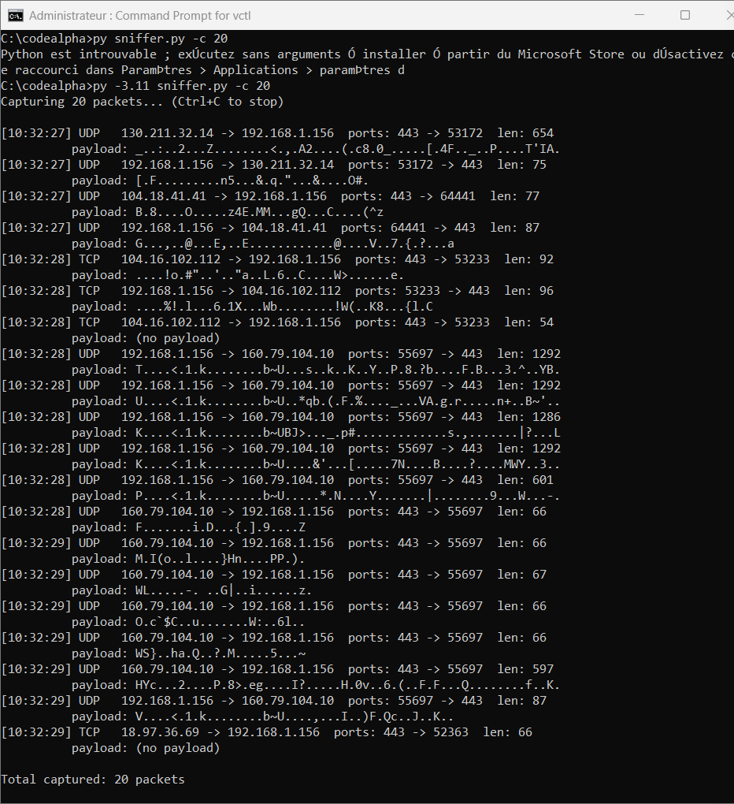
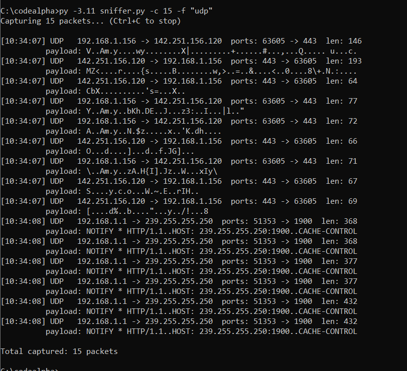
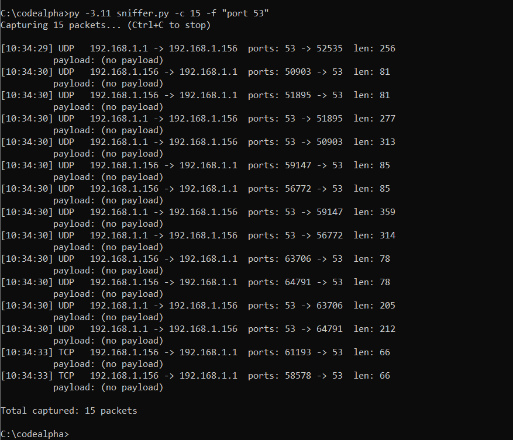
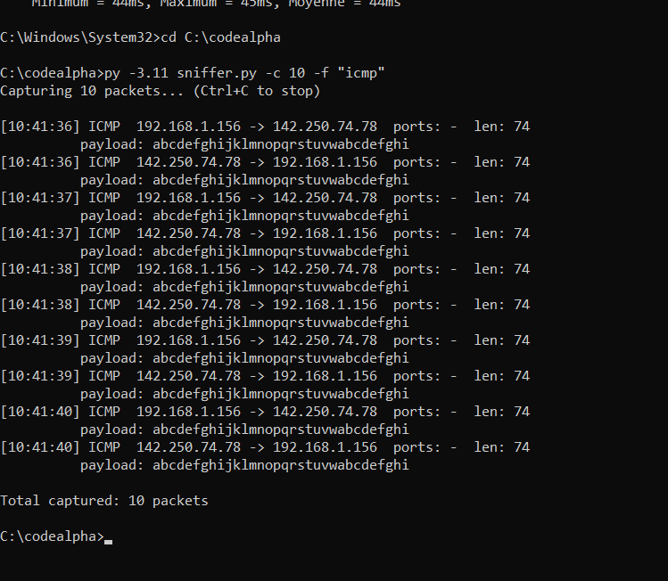
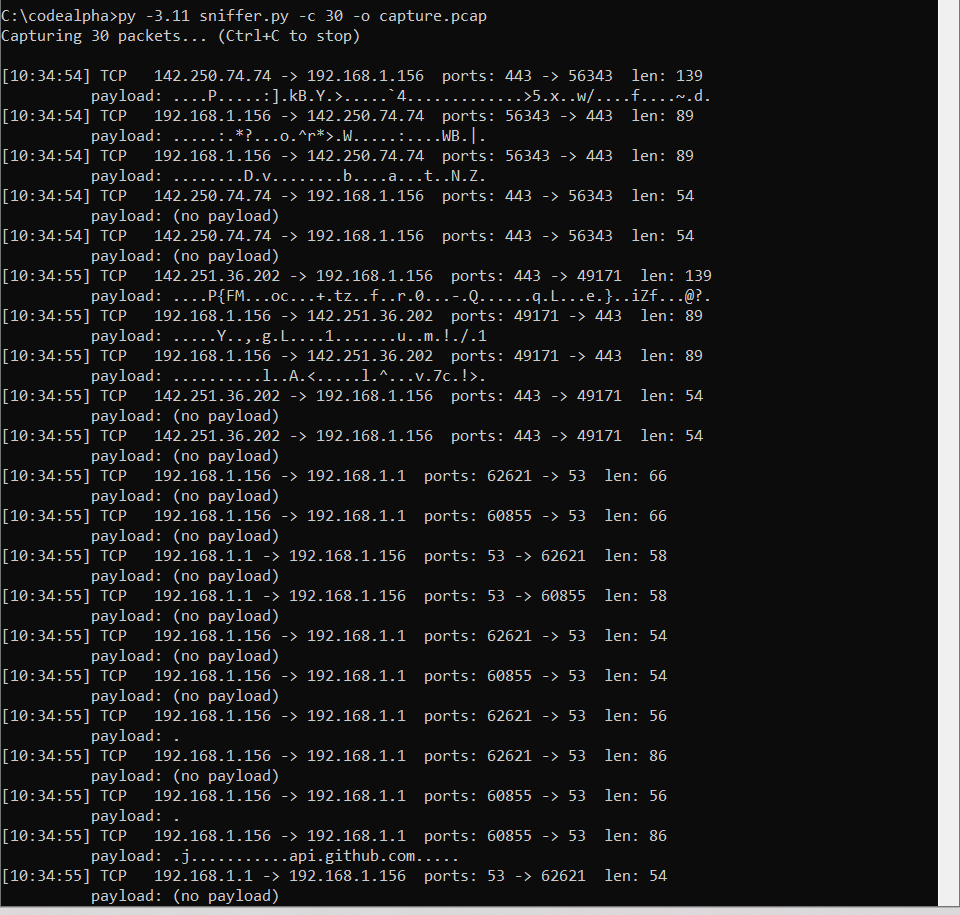

# Task 1: Basic Network Sniffer

Part of the **CodeAlpha Cyber Security Internship** (November 2026).

## Description
A Python network sniffer built with [Scapy](https://scapy.net/). It captures
packets from the network interface and displays:
- Source and destination IP addresses
- Protocol (TCP, UDP, ICMP, ARP)
- Source and destination ports
- Packet length and a preview of the payload

## Files
| File | Description |
|---|---|
| `sniffer.py` | The sniffer program |
| `capture.pcap` | A real capture saved by the program (can be opened in Wireshark) |
| `screenshot*.png` | Screenshots of the tests |

## Requirements
- Python 3.8+
- Scapy: `pip install scapy`
- Windows: install [Npcap](https://npcap.com/) and run the terminal as Administrator
- Linux/macOS: run with `sudo`

## Usage
```bash
python sniffer.py                       # capture 20 packets
python sniffer.py -c 50                 # capture 50 packets
python sniffer.py -f "udp"              # UDP only
python sniffer.py -f "port 53"          # DNS traffic
python sniffer.py -f "icmp"             # ping traffic
python sniffer.py -o capture.pcap       # save to a pcap file
python sniffer.py -i "Wi-Fi"            # choose an interface
```

## How it works
1. `sniff()` captures packets from the network interface.
2. Each packet is passed to `process_packet()`.
3. The layers (IP, TCP, UDP, ICMP, Raw) are inspected to extract the data.
4. Packets can optionally be saved to a `.pcap` file.

## Tests and results

### 1. General traffic (20 packets)
`py -3.11 sniffer.py -c 20`



### 2. UDP filter
`py -3.11 sniffer.py -c 15 -f "udp"`



### 3. DNS traffic (port 53)
`py -3.11 sniffer.py -c 15 -f "port 53"`



### 4. ICMP (ping)
`py -3.11 sniffer.py -c 10 -f "icmp"` while running `ping -n 10 google.com`



### 5. Saving to a pcap file
`py -3.11 sniffer.py -c 30 -o capture.pcap`



## Analysis
- **HTTPS / QUIC (port 443):** most of the traffic goes to port 443. Both TCP
  (HTTPS) and UDP (QUIC / HTTP3) packets appear, and their payload is
  unreadable because it is encrypted.
- **ICMP (ping):** requests and replies alternate (my PC `192.168.1.156` and
  Google `142.250.74.78`). ICMP has no ports. The payload is readable
  (`abcdefghijklmnopqrstuvwabcdefghi`) because ICMP is not encrypted.
- **DNS (port 53):** the DNS queries and answers are exchanged with the local
  router (`192.168.1.1`). The default DNS traffic is not encrypted, so anyone
  on the network could see which domains are requested.
- **Local network traffic:** in the UDP test, `NOTIFY * HTTP/1.1` messages sent
  to `239.255.255.250:1900` are SSDP (UPnP) announcements from a device on the
  network. They are also sent in clear text.
- **Packets without payload:** TCP control packets (acknowledgements, etc.)
  carry no data.

## What I learned
- Packets are built in layers (Ethernet, IP, TCP/UDP/ICMP, payload).
- TCP is reliable, UDP is fast and has no connection, ICMP is used for
  diagnostics.
- Encryption (HTTPS/QUIC) protects the content, while unencrypted protocols
  (ICMP, classic DNS, SSDP) expose their data to anyone who can sniff the
  network.

## Disclaimer
For educational purposes only. Capture traffic only on networks you own or
have permission to analyze.
