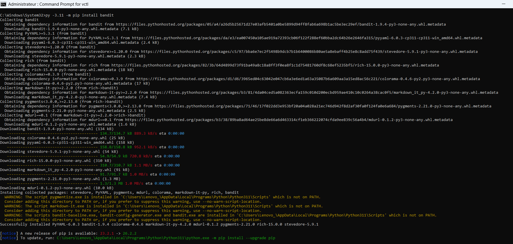
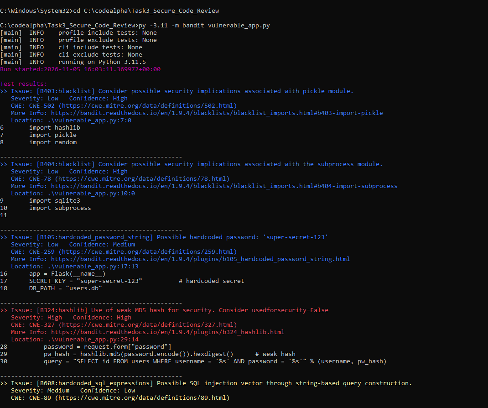
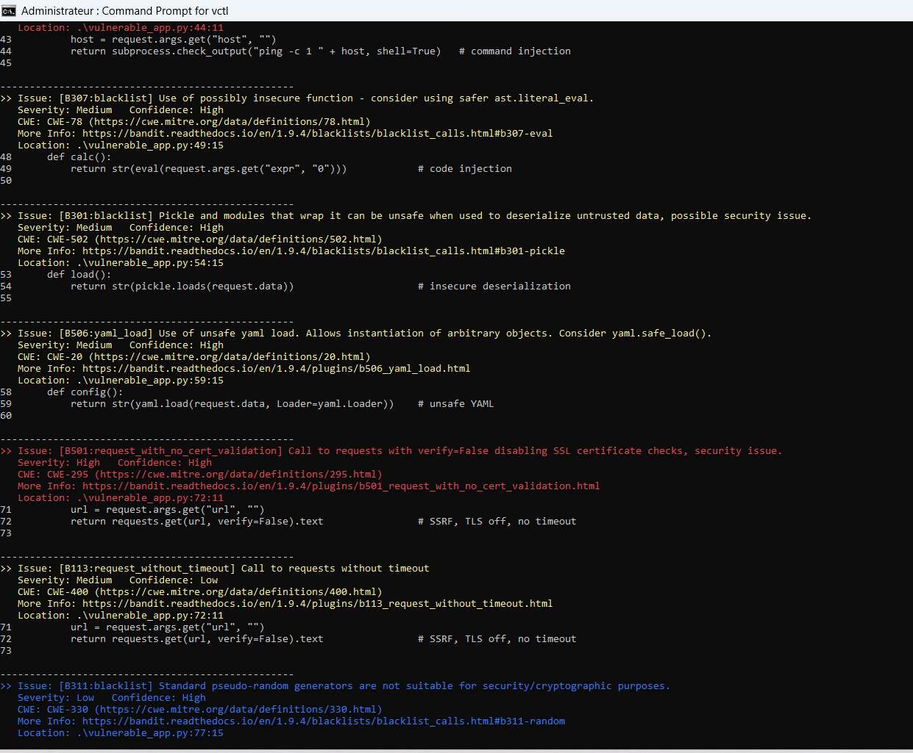
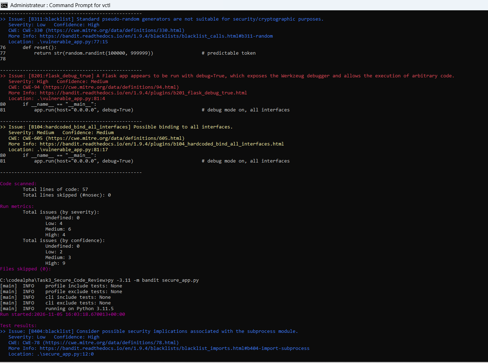
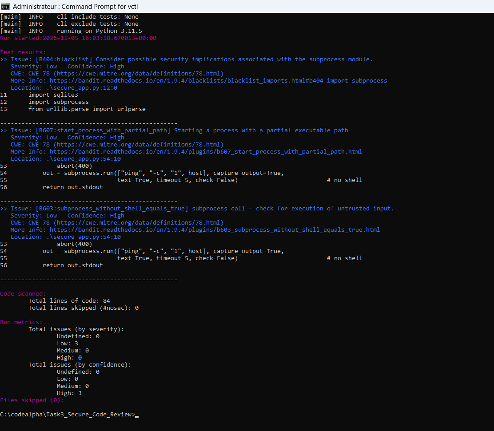

# Task 3: Secure Coding Review

Part of the **CodeAlpha Cyber Security Internship** (November 2026).

## Description
A security audit of a small Flask application written to be insecure for learning.
I reviewed it with the static analyzer **Bandit** and by manual inspection, documented every finding,
and wrote a fixed version.

## Files
| File | Description |
|---|---|
| `REPORT.md` | Full report: findings table, explanations, remediation, best practices |
| `vulnerable_app.py` | The audited code (intentionally insecure, never deploy it) |
| `secure_app.py` | The remediated version |
| `bandit_before.txt` | Bandit report for the vulnerable code (14 issues) |
| `bandit_after.txt` | Bandit report for the fixed code (3 informational Low issues) |
| `screenshot*.png` | Screenshots of my own Bandit runs |

## Results
- 15 vulnerabilities documented: SQL injection, command injection, `eval`, `pickle`, unsafe YAML, SSRF,
  path traversal, XSS, weak hashing, hardcoded secret, predictable token, debug mode and more.
- Bandit found 12 of them; 3 (SSRF, path traversal, XSS) needed manual review.
- After the fixes: High and Medium issues went from 10 to 0.

## Screenshots of my tests

### 1. Installing Bandit
`py -3.11 -m pip install bandit`



### 2. Scanning the vulnerable code
`py -3.11 -m bandit vulnerable_app.py`





Summary: 14 issues (4 High, 6 Medium, 4 Low).



### 3. Scanning the fixed code
`py -3.11 -m bandit secure_app.py`

Result: 3 issues, all Low (informational), 0 Medium, 0 High.



## How to reproduce
```bash
pip install bandit
bandit vulnerable_app.py
bandit secure_app.py
```

## Disclaimer
For educational purposes only. `vulnerable_app.py` contains deliberate security flaws.
